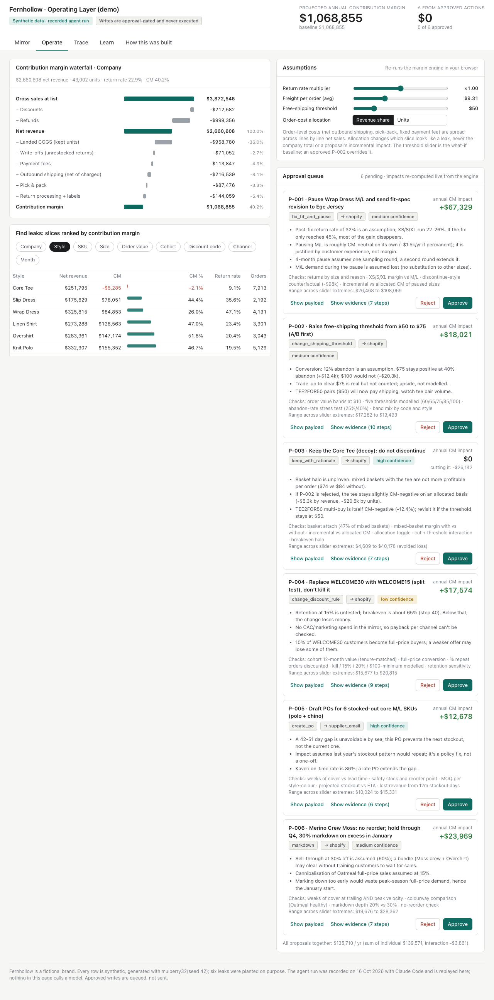

# Fernhollow · Margin Leak Finder

A miniature operating layer for a fictional DTC apparel brand, built to show GDPi's loop end to end:
- **Mirror:** systems of record are copied into one model.
- **Operate:** an agent reads through deterministic margin tools, and its writes are approval-gated.
- **Trace:** every step it takes is logged.
- **Learn:** human rejections become policy rules.

Fernhollow, its 24.5k orders and its six margin leaks are synthetic and planted on purpose. The agent run was recorded once with Claude Code and is replayed in the page. The whole thing ships as one offline HTML file.



## What to look at

- **Operate:** the company contribution-margin waterfall, leak ranking by any dimension, live assumption sliders, and the approval queue. Each card shows its exact write payload and links to its evidence.
- **Trace:** all 68 recorded steps. Counter-argument checks are highlighted, including the decoy save, where the Core Tee tops the loss list but is kept.
- **Learn:** reject a proposal with a reason and it becomes a rule. "Re-run policy check" replays the rules over pending proposals deterministically, with no model call.
- **How this was built:** assumptions, the planted leaks, and the agent's own hits and misses.

## Architecture

```
data-gen/assumptions.ts   every parameter (also rendered in the app)
data-gen/generate.ts      mulberry32(42) → data/*.json in Shopify / QuickBooks / 3PL / inventory field names
data-gen/summary.ts       Phase 1 realism assertions
engine/                   pure TS: model join, 11-step waterfall, allocation, cohorts, basket, inventory, scenario
tools/cli.ts              the agent's only window into the data; every call appends agent/trace.jsonl
agent/                    trace.jsonl, outputs/<step>.json, proposals.json, run-notes.md, actions/*.json
scripts/build-bundle.ts   packs the compact model + trace + proposals into the app
app/                      React UI; runs the same engine in the browser for the sliders
dist/index.html           the single self-contained deliverable (~2.1 MB)
```

The CLI and the browser use **one engine module**. The browser rebuilds the model from a compact encoding, and the bundle step asserts the round trip is exact.

## Commands

```bash
npm install
npm run gen                     # regenerate data/*.json (deterministic)
npx tsx data-gen/summary.ts     # Phase 1 realism assertions
npm test                        # engine unit tests (Vitest, hand-computed fixture)
npx tsx scripts/phase2-check.ts # engine reconciles to raw tables; decoy tee ranks as a loss
npm run build                   # bundle + vite → dist/index.html
npx tsx scripts/verify.ts       # 3-SKU hand recompute to the cent, evidence links, bundle hygiene
npx tsx scripts/screenshots.ts  # headless Chromium, network blocked: UI checks + screenshots/
```

**Re-running the agent.** Delete `agent/`, then drive `./fh <tool>` (a thin wrapper over `tools/cli.ts`). Run `./fh` with no arguments to list the tools. `propose` rejects any proposal whose impact doesn't match the scenario step it cites.

## Deploy

- **GitHub Pages (live now):** served from the `gh-pages` branch, which holds only `index.html` copied from `dist/`. To redeploy, run `npm run build`, then commit `dist/index.html` to `gh-pages` as `index.html`.
- **CI deploy (optional):** `deploy/github-pages-workflow.yml` tests, builds, verifies and deploys on every push. It isn't active because pushing workflow files needs the `workflow` token scope. To enable it, run `gh auth refresh -s workflow`, move the file to `.github/workflows/pages.yml`, push, and switch *Settings → Pages → Source* to **GitHub Actions**.
- **Netlify Drop:** drag `dist/` (or just `dist/index.html`) onto app.netlify.com/drop. The file has no external requests.

## Honest limitations

- **Synthetic data.** The leaks were planted by the same session that later ran as the agent, so the run proves tooling and reasoning discipline, not blind discovery. See `agent/run-notes.md`.
- **Recorded run.** The page replays a trace and never calls a model.
- **Writes are never executed.** Approve only marks a payload as queued.
- **Simple allocation model.** Order-level costs are spread by revenue share, with units as the alternative. Scenarios use incremental line removal. There is no marketing spend/CAC, exchanges, tax or air-freight data, and duty rates are blended, not per HTS code.
- **Scenario assumptions are point estimates** (abandon rate, retention, post-fix return rate, sell-through). They are listed on each proposal with a confidence level.

See `DECISIONS.md` for every judgment call, including the brief's order/customer/revenue inconsistency.
